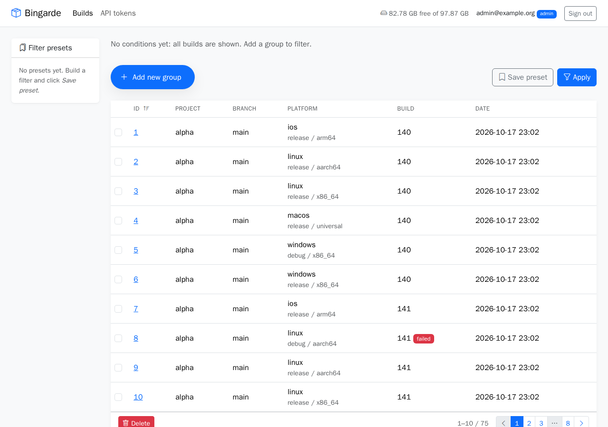
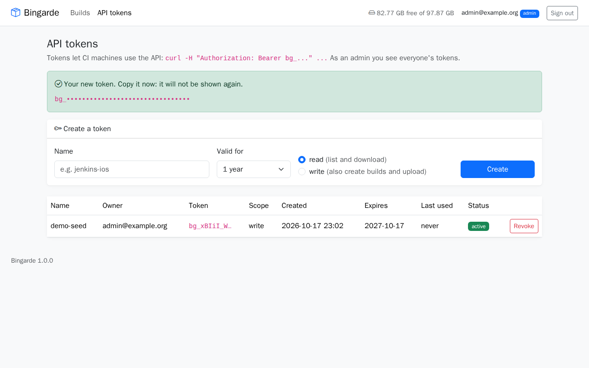
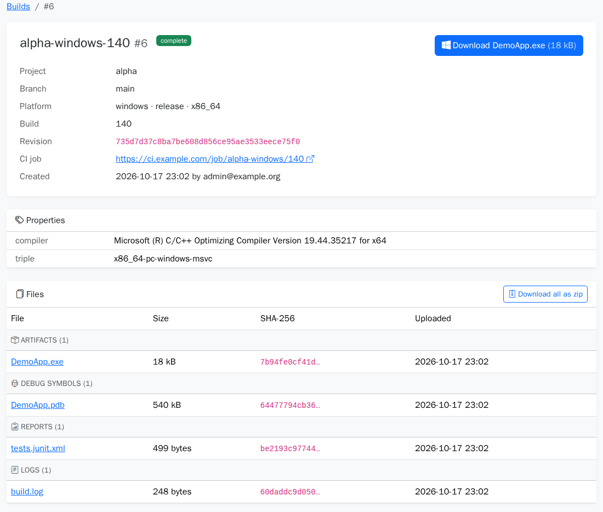

# Guide: build the demo and load it into Bingarde

This guide takes you from nothing to a running Bingarde server with **75 real builds**
in it: Windows `.exe` + `.pdb` made by MSVC, Linux binaries with `.debug` files, an iOS
`.ipa` and a macOS `.dmg` with their `.dSYM`, plus logs and test reports.

After the one-time setup, the whole run takes a few minutes: building all 75 variants
took about 1.5 minutes on an Intel Mac with a Windows PC next to it. Steps 1–6 were run
exactly as written here; the times and outputs shown come from those runs.



## What you need

| Machine | Needed for | What to install |
|---|---|---|
| Mac | the server, Linux, iOS and macOS builds | Docker with `docker compose` (Docker Desktop or Colima), Xcode with the iOS and macOS SDKs, Python 3, git |
| Windows PC (optional) | Windows builds with MSVC | Visual Studio 2022 with the **Desktop development with C++** workload, OpenSSH Server |

No Windows PC? Leave `WIN_HOST` out in step 4. The Windows builds are then made with
clang and lld (llvm-mingw) in Docker. They are real PE files with real PDBs, but the
self-test does not run, so they have no test report.

No Mac? The server, Linux and Windows parts work on any machine with Docker. iOS and
macOS builds need Xcode, so leave them out (see [Build only some platforms](#build-only-some-platforms)).

### One-time setup of the Windows PC

The Mac logs in to the PC with SSH and a key, without a password. Do this once.

1. In **PowerShell as Administrator**, install and start the SSH server:

   ```powershell
   Add-WindowsCapability -Online -Name OpenSSH.Server~~~~0.0.1.0
   Start-Service sshd
   Set-Service -Name sshd -StartupType Automatic
   ```

2. Put the Mac's public key (`~/.ssh/id_ed25519.pub`; make one with `ssh-keygen -t ed25519`
   if you have none) on the PC:
   - If your Windows user is an **administrator**, the key goes into
     `C:\ProgramData\ssh\administrators_authorized_keys`, and only Administrators and
     SYSTEM may read that file:

     ```powershell
     icacls C:\ProgramData\ssh\administrators_authorized_keys /inheritance:r /grant "Administrators:F" /grant "SYSTEM:F"
     ```

   - Otherwise it goes into `C:\Users\<you>\.ssh\authorized_keys`.

3. On the Mac, check that it works without a password prompt. Use the PC's name on your
   network (here `winpc.local`) or its IP address. The first time, answer `yes` to the
   host key question.

   ```bash
   ssh -o BatchMode=yes winpc.local ver
   ```

   Expected: `Microsoft Windows [Version 10.0....]`. The build script runs `cmd`
   commands, which is the default shell of OpenSSH on Windows; keep it that way.

## 1. Get the code

```bash
git clone --recurse-submodules https://github.com/<owner>/bingarde.git
cd bingarde
```

The demo is the `demo/` folder, a separate repository linked as a git submodule.
If `demo/` is empty, you cloned without `--recurse-submodules`; fix it with:

```bash
git submodule update --init
```

## 2. Start the server

```bash
docker compose --profile run up --build -d
```

The first start builds the app image and downloads PostgreSQL and nginx (about 1 GB);
this takes a few minutes. Later starts take seconds. Wait until this prints `200`:

```bash
curl -s -o /dev/null -w "%{http_code}\n" http://localhost:8080/health
```

A `502` in the first seconds is normal: nginx is up before the app.

Port 8080 already used? Pick another one, and use it in every URL below:

```bash
BINGARDE_PORT=8091 docker compose --profile run up --build -d
```

## 3. Sign in and create a token

1. Open <http://localhost:8080>. The demo setup has a developer login: type any e-mail.
   Use `admin@example.org`; that address is an admin.
2. Open **API tokens**, type a name (for example `demo-seed`), choose **write** and click
   **Create**.
3. Copy the token now. It starts with `bg_` and is shown only once.



## 4. Build the demo

```bash
cd demo
WIN_HOST=winpc.local ./build-all.sh
```

It builds 3 projects (alpha, beta, gamma) × 2 branches × 2 builds for every platform,
plus one failed Linux build per project. It ends with:

```
variants built: 75
```

What happens, and how long it took in our runs (the Docker images were already there):

| Platform | Where | Time |
|---|---|---|
| Linux x86_64 + aarch64 | gcc in Docker | about 5 s |
| Windows x86_64, release + debug | MSVC on the PC over SSH; the self-test runs there | about 7 s |
| iOS arm64 | Xcode on the Mac | about 20 s |
| macOS universal | Xcode on the Mac, packed into a `.dmg` | about 60 s |

The first run also builds the Linux build image (about 600 MB) and needs a few minutes
more. The three failed builds are failed on purpose: they are compiled with
`-DDEMO_BROKEN`, so their logs hold a real compiler error.

The results are in `out/<project>/<branch>/<build>/<platform>-<config>-<arch>/`. The
Windows PC keeps a copy in `C:\Users\<you>\bingarde-demo`.

Optional: check that the debug files really belong to the binaries.

```bash
./verify.sh
```

It reads one Windows `.pdb` and one Linux `.debug` file with `llvm-pdbutil` and
`readelf`. The first time it downloads the llvm-mingw image (1.6 GB).

## 5. Load the builds into the server

Still in `demo/`, with the token from step 3:

```bash
export BINGARDE_URL=http://localhost:8080
export BINGARDE_TOKEN=bg_...
./seed.py --from out
```

It works like a CI job: each build is created as `uploading`, its files are uploaded,
then it is marked `complete` or `failed`. It took 4 seconds and ends with:

```
seeded 75 builds, 255 files
```

`--from` also takes a `.zip` file or the URL of one, so you can load builds that were
made on another machine. `--replace` first deletes all builds on the server; it needs an
admin's token.

## 6. Look at the result

Open <http://localhost:8080>. You should see 75 builds: 72 `complete` and 3 `failed`.
Open a Windows build: the compiler is MSVC, and the files are grouped by role.



| Role | Files |
|---|---|
| artifact | 72 (`.exe`, `.tar.gz`, `.ipa`, `.dmg`) |
| symbols | 72 (`.pdb`, `.debug`, `.dSYM.zip`) |
| log | 75 |
| report | 36 (JUnit XML from the self-tests) |

Click `DemoApp.pdb` to download it. It is the same file as in `out/` (compare with
`shasum -a 256`). Try the filters too: for example **Status is failed** finds the three
broken builds.

## Build only some platforms

`build-all.sh` writes one list per platform into `variants/` and then runs the platform
scripts. To build only some platforms, run `build-all.sh` once and then the scripts you
need on their own, for example:

```bash
sh build-linux.sh variants/linux.txt
WIN_HOST=winpc.local sh build-windows-msvc.sh variants/windows.txt
sh build-windows.sh variants/windows.txt     # Windows with llvm-mingw in Docker instead
```

`seed.py` loads whatever is in `out/`.

## Troubleshooting

| Problem | Fix |
|---|---|
| `./build-all.sh: Permission denied` | Your copy lost the executable bit: run `sh build-all.sh`, or `chmod +x *.sh seed.py`. |
| `Could not resolve hostname winpc.local` | The PC is off, asleep or on another network. Use its IP address in `WIN_HOST`. |
| `Permission denied (publickey)` or a password prompt | The key is in the wrong file. Administrators need `administrators_authorized_keys` with the `icacls` command above. |
| `MSVC not found` | Visual Studio has no C++ workload. Add **Desktop development with C++** in the Visual Studio Installer. |
| `port is already allocated` | Start the server with another `BINGARDE_PORT`. |
| `502 Bad Gateway` right after the start | Wait a few seconds and try again. |
| `this API token is read-only` | Create the token with the **write** scope. |
| `admin rights required` with `--replace` | Sign in as `admin@example.org` before you create the token. |

## Clean up

```bash
docker compose --profile run down -v      # in the bingarde folder; -v also deletes the data
rm -rf demo/out demo/variants
```

On the Windows PC, delete the folder `C:\Users\<you>\bingarde-demo`.
